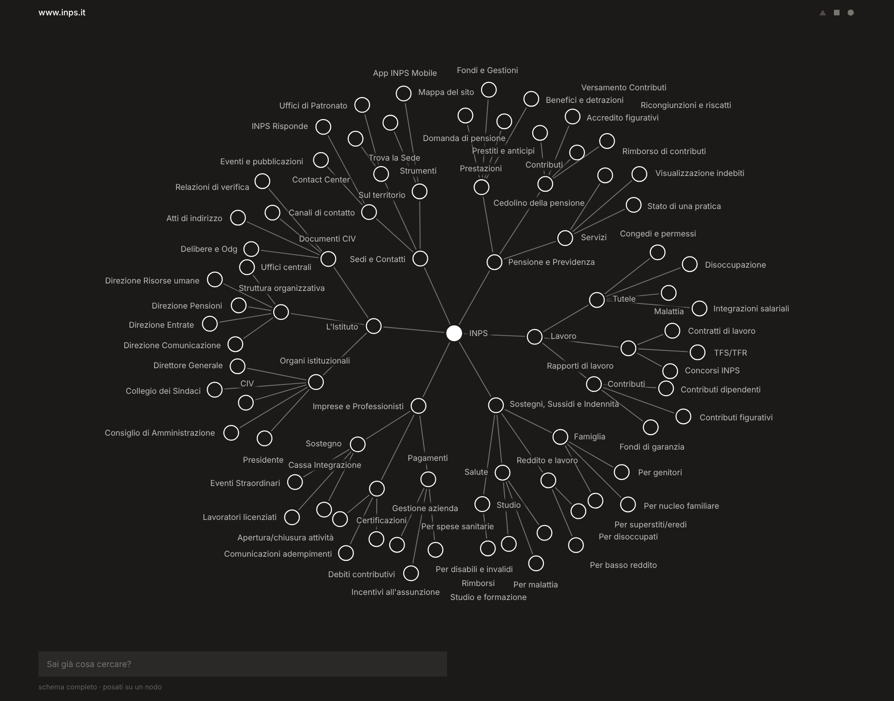

# Web Node

Un navigatore per orientarsi nei siti web.

Web Node disegna la struttura di un sito come una mappa a nodi navigabile: ogni nodo è una pagina, ogni ramo una sezione. È lo strumento digitale della tesi [*Design ostativo*](https://doi.org/10.5281/zenodo.21515611) di [Lorenzo Casetta](https://github.com/LorenzoCasetta), Università Iuav di Venezia, 2026.

[Apri il prototipo online](https://lorenzocasetta.github.io/design_ostativo/) · [Scarica l'estensione 4.1.5](https://github.com/LorenzoCasetta/design_ostativo/raw/main/Versione%204/Web_Node_4.1.5.zip) · [Leggi la tesi](https://doi.org/10.5281/zenodo.21515611)

## Versione corrente

[Web Node 4](Versione%204/) è un’estensione per browser Chromium. Si apre dall’icona del browser sul sito che si sta visitando e ne disegna i collegamenti in una finestra sopra la pagina.

- La finestra si sposta, si ridimensiona e può dividere la pagina a metà con il sito.
- La mappa si ingrandisce e segue il puntatore.
- I titoli dei nodi hanno una lunghezza massima; un clic su un nodo apre la pagina.

[Installazione e comandi](Versione%204/README.md) · [Changelog](Versione%204/CHANGELOG.md)

## Versioni

| Versione | Che cos’è | Novità principali |
| --- | --- | --- |
| [Versione 4](Versione%204/) | Estensione Chromium 4.1.5, attuale · [scarica](https://github.com/LorenzoCasetta/design_ostativo/raw/main/Versione%204/Web_Node_4.1.5.zip) | Finestra dentro la pagina, spostabile e ridimensionabile; divisione rifatta; titoli più corti |
| [Versione 3](Versione%203/) | Prima estensione Chromium, 3.0.0 · [scarica](https://github.com/LorenzoCasetta/design_ostativo/raw/main/Versione%203/Web_Node_3.0.0.zip) | La mappa nasce dai collegamenti della pagina aperta; zoom |
| [Versione 2](Versione%202/) | Prototipo web, prima versione funzionante online · [apri](https://lorenzocasetta.github.io/design_ostativo/) | Livelli concentrici, etichette vicine ai nodi, motore separato dai dati |
| [Versione 1](Versione%201/) | Prototipo originale, funzionante solo offline | Mappa di inps.it con ricerca, schema completo e vista affiancata |

## Limiti e privacy

La compatibilità con ogni sito web non è garantita. La mappa rappresenta i collegamenti rilevati nella pagina corrente, non una scansione completa del sito.

Web Node non raccoglie dati di alcun genere: i collegamenti sono elaborati nel browser e nulla viene inviato a server esterni.

## Sviluppi previsti

Nella versione 5 la scansione del sito avverrà tramite AI, con un piano a consumo.

## Ricerca

Casetta, L. (2026). *Design ostativo. I dark pattern e l’asimmetria normativa tra privato e pubblica amministrazione*. Università Iuav di Venezia. [https://doi.org/10.5281/zenodo.21515611](https://doi.org/10.5281/zenodo.21515611)

Per citare il progetto si può usare il pulsante «Cite this repository» di GitHub, generato da [CITATION.cff](CITATION.cff).
